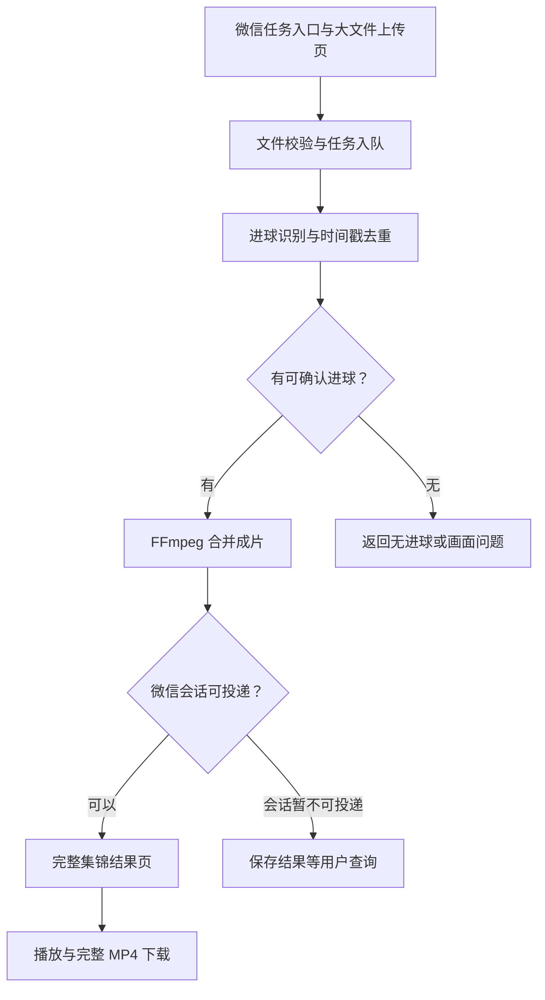

# 篮球进球剪辑 Agent · 产品需求文档

版本 v0.2 · 2026-11-25 · 讨论稿

## 1. 产品目标

让业余球队、校园球赛的拍摄者或球员，从微信客服「篮球集锦助手」提交一场约 40 分钟的篮球录像，自动生成进球集锦，再在微信里领取、播放和下载。整场原片可能达到数 GB，集锦也可能有数十至数百 MB，大文件上传和完整画质交付均为首版核心能力。系统负责识别进球时间、裁剪、合并和交付。

首版以单机位、横屏、篮筐清楚可见的手机录像为目标，优先做固定或轻微移动机位，支持半场以及全场录像中确实拍到进球的画面。产品承诺是「从拍清楚的镜头里找进球」，画面外的进球和被遮挡的结果属于无法判断。首版以约 40 分钟整场录像为核心验收样例，建议支持最长 60 分钟、单文件最大 5 GB，以先到达的限制为准。该容量为产品建议，需要按真实拍摄码率调整。更长录像作为扩展。机位、容量、清晰度和时延指标均为本稿建议。

## 2. 首版体验

1. 用户从二维码或客服链接进入微信客服，发送「剪辑比赛」或「上传」，收到绑定当前任务的上传入口。在微信内打开上传页，选择整场视频并直传私有对象存储，展示进度、已传大小和重试状态。小文件仍可尝试聊天直传。上传页是大文件的标准入口，微信内选文件和后台恢复能力须真机验证。
2. 原片上传完整并通过校验后，助手回复「已收到，正在找进球。回复『进度』可查询。」每次提交生成任务编号。单用户同时最多处理 1 个任务，其他提交返回当前任务状态。
3. 系统识别画面中可确认的进球，以进球时刻为锚点，默认保留前 5 秒、后 2 秒，按原时间顺序合并为一条 MP4。相交区间合并，同一次进球只算一次。片段遇到源视频边界时截到实际边界。
4. 生成后在微信发送结果页，提供完整进球集锦播放、逐球时间点和完整画质 MP4 下载。输入源足够清晰时，下载版目标保留 1080p。另生成适配网络的播放版本。小体积结果可附加微信原生视频，媒体大小限制不得导致截短集锦或强行降低完整下载版画质。
5. 特殊结果有明确提示。已完成分析但未找到可确认进球时，提示「未识别到清晰可确认的进球」。篮筐大部分时间不可见或画面无法判断时，提示具体拍摄问题。文件损坏、模型超时和投递失败分别归因。若会话无法主动回传，用户回来发「结果」后可尝试重新获取仍在保留期内的成片。

## 3. 范围与优先级

| 优先级 | 模块 | 功能与验收 |
|---|---|---|
| P0 | 微信接入 | 配置可访问的官方客服会话。服务端接收回调、读取视频消息、下载素材并建任务。重复回调测试下，同一条入站消息只建一个任务。 |
| P0 | 通用上传与校验 | 上传页支持 MP4、MOV，建议最长 60 分钟、最大 5 GB，以先到达的限制为准。分块直传、上传进度、失败块重试、断点续传与完成校验均为 P0。刷新后可重新选取同一文件恢复，切后台和锁屏的行为须实测。微信直传是补充入口。校验实际容器、编码、完整性和时长，手机 HEVC 等输入支持情况纳入验收矩阵。 |
| P0 | 进球识别 | 一次进球对应一个事件。输出源视频秒级时间戳、置信度和证据类型。区分确认进球、出手未进、无法判断三种标注，只有确认进球进默认集锦。 |
| P0 | 剪辑与回传 | 输出 H.264/AAC 的 MP4，保留原声（如有），按时间排序，完整下载版目标 1080p（受源画质限制），另提供适配网络的播放版本。保存事件清单和完整成片，微信返回结果页，小文件可附加原生视频。 |
| P0 | 状态与恢复 | 支持「进度」「结果」「上传」。生成失败和投递失败独立记录，投递重试复用成片。按客服账号、用户与入站消息 ID 建立幂等键，投递尝试记录独立消息 ID。超限、过期和没有可用结果各有清晰文案。 |
| P0 | 私有访问与清理 | 上传会话与任务归属绑定。结果页采用短时访问凭证，禁止公开索引，私有存储。备用结果页仅供提交者领取，下载后的 MP4 可由用户自行分享。建议原片保留 24 小时，成片保留 7 天。 |
| P1 | 剪辑调整 | 用户选「加长前摇」、查看逐球片段、标记漏剪和误剪。用反馈改进识别和裁剪。 |
| P2 | 更多素材与能力 | 超过 60 分钟的录像、多机位、竖屏或大幅跟拍、球员归属、按球队分段、比分叠加和个性化字幕。 |

P0 验收样例至少覆盖五种业务结果：原生视频回传、40 分钟大原片上传及高码率完整集锦领取、有多次出手但零命中、篮筐不可见、任务完成后会话暂时无法投递。另做双用户隔离和重复回调测试。付费、分发平台和专业编辑器留待验证产品价值后再定。

## 4. 渠道方案与平台验证

| 路线 | 体验 | 适用时机 |
|---|---|---|
| 官方微信客服 | 客服承接需求、任务通知和查询，上传页承接大原片，结果页承接完整成片播放及下载。 | v0.2 推荐，先确认账号能力和微信内页面体验。 |
| 微信小程序 | 小程序负责选大文件、进度和结果，从微信会话跳转。交互更完整，开发和发布成本更高。 | H5 在目标手机上选取长视频或恢复上传受限时，作为替代路线验证。小程序自身选片和前后台约束也需实测。 |
| 独立网页 | 浏览器上传和领取结果，能用相同的识别与剪辑流程。 | 主体或接口权限尚未落实时用于内部验证，微信闭环的验收仍须使用真实客服。 |

接口文档显示，客服回调之后需通过 `kf/sync_msg` 主动读取消息，视频包含 `media_id`。客服发送视频使用 `kf/send_msg` 与上传临时素材取得的 `media_id`。发送接口文档列出的标准规则为用户主动发消息后 48 小时内最多发送 5 条，并受会话状态、权限限制。普通临时素材视频上传文档写明 MP4、10 MB。出站素材上限不等于用户在微信端可提交的上限。完整原片和完整集锦通过对象存储上传与下载，结果页为标准交付入口。原生视频仅用于符合实测平台限制的小成片或预览。10 MB 限制不能成为整场输入或完整成片的产品上限。普通文件发送和其他大素材接口的兼容性仍需按微信客服具体接口验证。常规过程只主动发「收件确认」和「结果」两条，进度由用户主动查询。消息额度按会话管理。

**真机验证通过条件**：用目标账号和真实 iOS、Android 微信客户端完成 40 分钟原片选择、分块上传、失败重试、刷新重选同文件续传、任务查询和完整成片领取。覆盖 500 MB、2 GB、接近 5 GB 的有效视频及超过限制的样例。记录切后台、锁屏和网络切换行为，展示继续上传提示。验证完整成片无截断、无强制压到 10 MB、能播放并在目标手机完成下载或保存。记录超限、回复窗口关闭、素材失效的真实行为。验证上传页和结果页在微信内能访问，并检查下载完成后的系统相册或文件保存路径。客服账号能否开通接口、平台入口的实际可用性仍待实测。

## 5. 识别与剪辑方案

**进球定义**：画面有足够证据表明球从篮筐上方穿过篮筐。打铁、碰框弹出、回放重复和仅有庆祝或记分变化不得单独判为命中。球过框时刻由人工标注，发生明显遮挡时独立标记为无法判断。

| 方案 | 怎么做 | 取舍 |
|---|---|---|
| 多模态模型基线 | 视频分段并适当重叠，让模型输出候选进球、时间和证据。将片段内时间转换到原视频时间，统一去重。 | 用于快速建立基线。长录像成本、定位误差和漏检需要实测。 |
| 篮筐附近候选＋模型复核 | 用篮筐区域及球的时序轨迹提议候选，对候选前后短窗口采样复核。初版可使用固定机位的篮筐区域先验。音量或可见比分可作为辅助信号。 | 优先比较更低成本、更精确的定位，重点观察小球丢失、遮挡和候选漏检。 |
| 自训时序事件检测 | 积累多场比赛的标注后，学习进球与相似负样本的时序差异。 | 样本和训练投入更高，先观察基线错误是否值得自训。 |

初版先跑多模态基线，再用同批测试录像比较「候选＋复核」的召回率、精确率、定位误差和单分钟成本。若增量版本能在保住召回的同时降低误剪或推理成本，再替换默认路径。剪辑由 FFmpeg 按经过校验的时间戳执行。Agent 的具体职责是编排下载、识别、渲染、选择回传方式和失败恢复。任务状态由服务端记录。

## 6. 指标与验收口径

以下为内测门槛提案，须根据基线和测试成本校准。建议用至少 10 场不同场地、合计至少 100 个清晰进球的授权录像建立独立测试集，额外覆盖零进球、打铁、进球遮挡和镜头离开篮筐等案例。按比赛分割开发集和测试集，并单独报告篮筐可见与不可判断素材的比例。

| 指标 | 建议目标与口径 |
|---|---|
| 事件精确率 | ≥85%。确认进球预测与人工标注一对一匹配，时间差 ≤2 秒。重复报同一球记误报。 |
| 事件召回率 | ≥75%。分母为首版支持场景中人工标注的可确认进球。明确记录因拍摄看不清而无法判断的样本量和占比。 |
| 片段完整率 | ≥90%。在命中的事件中，人工检查片段同时包含关键出手与过框，并单独记录原片首尾缺失。 |
| 处理时延 | 对 40 分钟完整录像，初始优化目标为 P90 ≤20 分钟，须由真实算力和模型基线校准，通过实测前不对外承诺。从校验完成计到结果可用，排队与推理都计入。另记上传与微信投递耗时。 |
| 交付成功率 | 内测目标 ≥95%。分母是合法且通过校验的任务，分子是成片或真实业务结论已成功送达的任务。统计首轮送达与用户查询后取回，另列完整成片下载成功率和原生视频回传占比。 |
| 推理成本 | 记录每输入视频分钟的模型调用成本、GPU 时间和编码耗时。按机位、光照、远近篮筐分组报告效果。 |

## 7. 开发顺序与待决项

1. **先做接入验证**。用同一客服账号派发上传入口，完成 40 分钟、至少 2 GB 原片上传，再将超过 10 MB 的完整测试成片通过结果页交付。同步验证短视频直传和回传，产出 iOS、Android 微信的选片、上传恢复、播放及保存实测矩阵。
2. **建立识别基线**。对已授权样例标注进球时刻，跑模型、计算指标、导出集锦。产出可人工复盘的时间轴、误报漏报样例和处理成本。
3. **合并为内测闭环**。接入任务队列、结果回传、用户查询、重试、存储过期和访问控制。班级或球队试用后，根据真实素材迭代。
4. **完善整场识别效率**。按可配置时长切块并保留重叠区间，统一映射原始时间轴，跨块去重。失败只重试对应块，渲染从原片按时间点取材。用真实误报漏报决定是否引入本地候选检测。

影响下一版的两项产品决策：首批用户主要交校园/野球手机录像，还是带比分牌的赛事录像；首轮是否已有能开通官方客服 API 的主体与账号。前者会改变评测集和可用线索，后者决定微信闭环的验证排期。进入识别内测前，还需确认授权录像来源、允许的数据处理边界以及单视频成本与算力预算。第三方推理需要素材授权覆盖相应处理方式，否则使用本地推理。样本量不足时可用小样本做可行性验证，正式指标继续等待独立测试集。

## 8. 大文件交付说明

建议架构为微信客服＋微信内 H5 上传/结果页＋私有对象存储＋异步识别剪辑任务。完整原片直传对象存储，任务服务使用短时授权访问。对大文件采用分块上传，服务端验证所有分块合并成功后才进入识别队列。上传进度与分析进度分别显示。

成片大小由时长和码率决定。例如 40 分钟原片按 8 Mbps 估算约 2.4 GB，3 分钟集锦按 4 Mbps 估算约 90 MB，均为十进制近似、未额外计算音轨和封装。完整集锦通过私有结果页播放和下载，源文件与下载版大小相互独立。30 个进球各保留 7 秒可形成约 3.5 分钟集锦，实际长度由事件数量、重叠合并和裁剪配置决定。

微信聊天原生大附件交付是否可行仍需按目标接口验证。本稿推荐的可实现路径会增加点击上传/结果页这一步；如果产品必须让用户直接在聊天气泡里上传和收到大附件，需要先做专门的渠道可行性验证，再确认接入方式。

## 9. 参考资料

- 腾讯云 [JavaScript SDK 上传对象](https://cloud.tencent.com/document/product/436/64960)，分块上传、暂停恢复和刷新后重新选择同一文件续传的能力说明。

- 企业微信开发文档 [接收消息和事件](https://developer.work.weixin.qq.com/document/path/94670)、[发送消息](https://developer.work.weixin.qq.com/document/path/94677)、[上传临时素材](https://developer.work.weixin.qq.com/document/path/90253)。
- 可访问的接口文档镜像 [读取消息](https://s.apifox.cn/apidoc/docs-site/406014/api-10061327)、[发送消息](https://qiyeweixin.apifox.cn/api-10061328)、[上传临时素材](https://s.apifox.cn/apidoc/docs-site/406014/api-10061699)。上述账号权限、客户端表现和媒体边界以接入实测为准。
